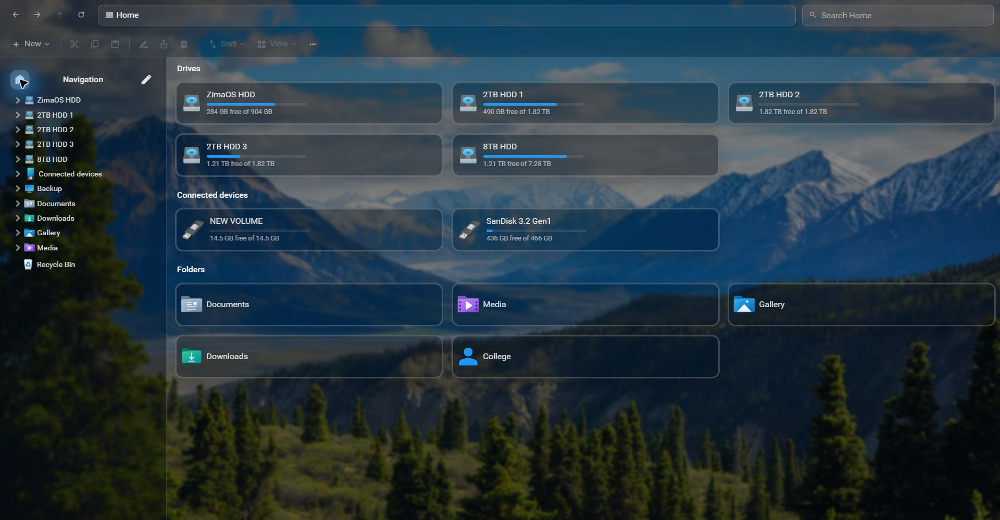
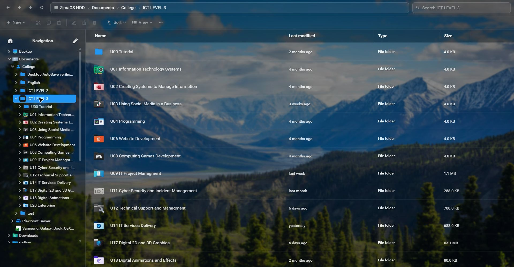
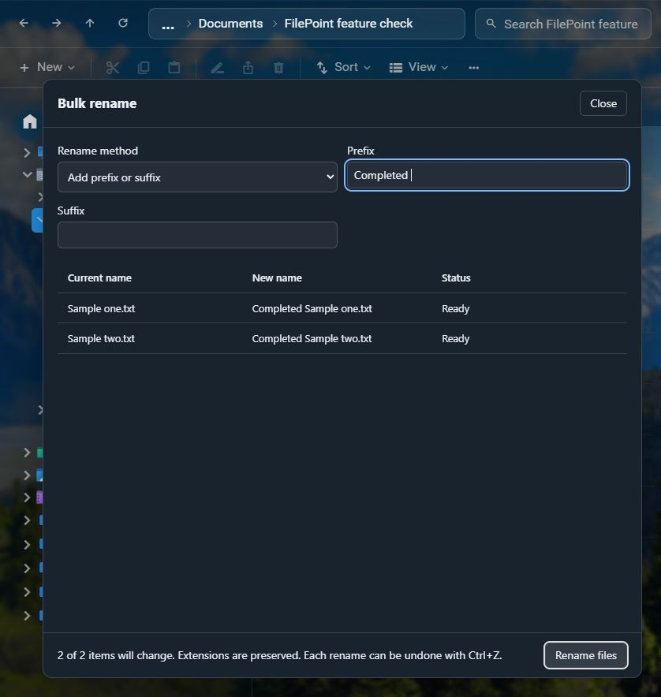
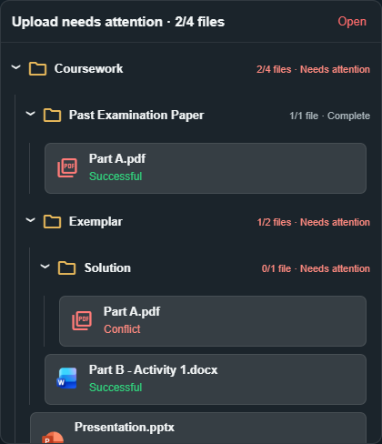
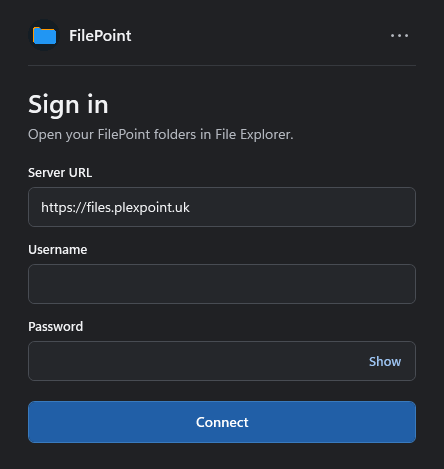

<p align="center">
  
</p>

<h1 align="center">FilePoint Server</h1>

<p align="center">
  Browse your ZimaOS storage, manage files, and edit documents from your browser.
</p>

<p align="center">
  <a href="#configure-an-instance"><strong>Server setup</strong></a> ·
  <a href="#a-look-inside-filepoint">Screenshots</a> ·
  <a href="https://github.com/JNathan34/FilePoint-Windows-Downloads/releases/latest">Download for Windows</a>
</p>

## A look inside FilePoint

### Home

See your drives, available space, connected devices, and pinned folders in one place.

[](docs/images/filepoint-home.jpg)

### Documents › College › ICT LEVEL 3

The folder tree and custom icons make it easy to find a course unit.

[](docs/images/ict-level-3.jpg)

### File tools

<table>
  <tr>
    <td width="53%" valign="top">
      <strong>Preview changes before renaming files</strong><br>
      Add a prefix or suffix to multiple files at once.<br><br>
      <a href="docs/images/bulk-rename.png"></a>
    </td>
    <td width="47%" valign="top">
      <strong>See how each upload is doing</strong><br>
      Track uploads by folder and see which files need attention.<br><br>
      <a href="docs/images/grouped-uploads.png"></a>
    </td>
  </tr>
</table>

- **Browse and find files.** Use the folder tree, custom folder icons, and search to navigate your storage. Recover deleted items from the Recycle Bin.
- **Edit documents.** Open supported files in ONLYOFFICE from the browser. Microsoft editing can be configured separately.
- **See connected storage.** The host broker can surface mounted USB drives in FilePoint. An optional Android helper handles phones that use MTP.

## Use FilePoint in Windows Explorer

<table>
  <tr>
    <td width="58%" valign="middle">
      <strong>One server for the browser and Windows</strong><br><br>
      Install FilePoint for Windows, then sign in with your FilePoint server URL. Your accessible folders appear as a drive in File Explorer.<br><br>
      <a href="https://github.com/JNathan34/FilePoint-Windows-Downloads/releases/latest"><strong>Get the x64 or ARM64 installer</strong></a><br>
      <a href="https://github.com/JNathan34/FilePoint-Windows-Downloads">Browse the Windows app source</a>
    </td>
    <td width="42%" align="center">
      <a href="docs/images/windows-sign-in.png"></a>
    </td>
  </tr>
</table>

## Configure an instance


Use a Linux host with Docker Compose, systemd, and Python 3.11 or later. ZimaOS normally uses `/DATA/AppData/plexpoint-files-office` for the application directory. Use a separate host or test instance to try the example Compose project; for an existing ZimaOS deployment, use the Compose project managed by CasaOS.

1. Copy `docker-compose.example.yml` to `docker-compose.yml`. Set `FILEPOINT_DATA_DIR`, `FILEPOINT_STORAGE_DIR`, and `FILEPOINT_BIND_IP` in a local `.env` as needed. Edit the bind mounts to match the server's actual storage. Create the mount points and runtime directories before starting the stack.
2. Copy `filebrowser/config.example.yaml` to `filebrowser/config.yaml` and `office.env.example` to `office.env` in the application directory. Set the FileBrowser and ONLYOFFICE URLs. Generate unique values for the admin password, FileBrowser signing key, and ONLYOFFICE JWT secret. Set the same JWT secret in both ONLYOFFICE and the FileBrowser integration. Restrict access to both local config files.
3. Copy `storage-map.example.json` to `storage-map.json` and match its names and host paths to the FileBrowser sources and mounts. To opt into native writes, copy `native-write-sources.example.json` to `native-write-sources.json` and list only the sources that should support native writes. Adjust the systemd unit or a local drop-in for the app directory, bind and upstream addresses, and writable directories. The proxy needs the `home-layout`, `hidden-items`, `folder-material-icons`, `microsoft-bridge`, and `operation-history` directories.
4. Validate Compose with `docker compose config --quiet` on the target host before starting it. Install the proxy service once the upstream is reachable. Route the public FilePoint URL through a TLS reverse proxy to FilePoint on port 8704. If the reverse proxy runs off host, set the FilePoint listener and firewall rules for that host. Keep the FileBrowser upstream and host administration interfaces private.
5. Configure optional integrations separately. The Microsoft bridge uses local OAuth or rclone configuration; connected storage requires the host broker. Leave the Android helper off until it can be tested with a physical phone on the target host.

Live configuration, account databases, storage contents, session and verification data, and server backups are outside this repository. Keep those in your private ZimaOS backup process if you need to restore the entire instance.

## What runs on the server

| Part | Where to look |
| --- | --- |
| FilePoint API and web UI | [`foldericons/`](foldericons/) contains the Python proxy, browser client, assets, and tests. |
| FileBrowser Quantum and ONLYOFFICE | [Compose example](docker-compose.example.yml) and [FileBrowser config template](filebrowser/config.example.yaml). |
| Host services and Android helper | [Connected storage notes](foldericons/CONNECTED-STORAGE.md), systemd units, and the [Android helper](foldericons/android/). The Android image fetches upstream jmtpfs and applies the included patch. |


## Checks

```sh
python3 -B -m unittest discover -s foldericons -p 'test_*.py'
node --check foldericons/client.js
node --check foldericons/connected_storage_client.js
```

Run the Python suite on Linux: the native file tests rely on Linux filesystem operations. Browser and live HTTP checks under `foldericons/` have additional setup requirements and some require a running test instance.
